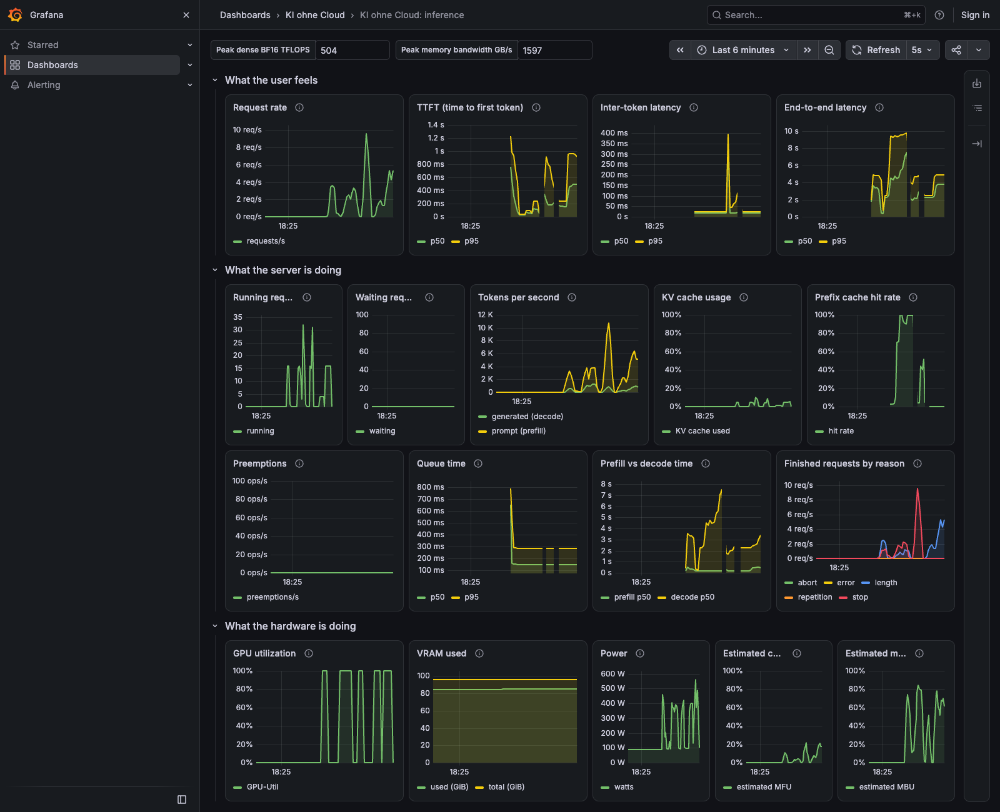

# Monitoring

What to watch while an inference server runs, and two ways to run the same stack.

```text
vLLM (/metrics) ──┐
                  ├──► Prometheus ──► Grafana (dashboard "KI ohne Cloud: inference")
GPU exporter ─────┘
```

## Two deployments, one configuration

| | Workshop pods | Your own server |
| --- | --- | --- |
| How it runs | plain processes started by `wsmon` (pods are containers and cannot run Docker) | `docker compose` |
| GPU metrics | `gpu-exporter/exporter.py` (NVML, DCGM metric names) | NVIDIA `dcgm-exporter` |
| Prometheus config | `prometheus/prometheus.pod.yml` (loopback targets) | `prometheus/prometheus.yml` (service names) |
| Grafana | `pod/grafana.ini`, provisioning from `grafana/provisioning` | the same provisioning, mounted |
| Dashboard | `grafana/dashboards/workshop-inference.json` | the same file |

The pod exporter publishes the DCGM metric names the dashboard uses (`DCGM_FI_DEV_GPU_UTIL`, `DCGM_FI_DEV_FB_USED`, `DCGM_FI_DEV_POWER_USAGE`), so the dashboard does not know which exporter feeds it.

## On a workshop pod

```bash
sudo wsmon status                    # (trainer) processes and whether they answer
ssh -L 3000:127.0.0.1:3000 <user>@<gpu-host> -p <port>
# then open http://127.0.0.1:3000 on your laptop
```

Everything binds to `127.0.0.1`. Access is through your SSH tunnel; nothing is exposed publicly.

## On your own server

```bash
cp .env.example .env                 # set VLLM_API_KEY
docker compose -f monitoring/docker-compose.yml --env-file .env up -d --build
```

All ports are published on `127.0.0.1` only. `--api-key` protects `/v1` but not `/metrics`, `/health` or `/tokenize` (see `docs/RESEARCH.md` 3.7), so keep the server off public interfaces.

## The dashboard

`grafana/build_dashboard.py` generates the dashboard JSON; `grafana/test_dashboard.py` checks that every PromQL metric name is one vLLM v0.31.0 actually exports. To change a panel, edit the generator, run it, and commit both.

| Row | Panels | Question it answers |
| --- | --- | --- |
| What the user feels | request rate, TTFT, inter-token latency, end-to-end latency | are users waiting, and for what? |
| What the server is doing | running, waiting, tokens/s, KV cache usage, prefix cache hit rate, preemptions, queue time, prefill vs decode time, finish reasons | is the scheduler saturated, is memory the limit? |
| What the hardware is doing | GPU utilization, VRAM, power, estimated MFU, estimated MBU | what resource is busy? |

Read the hardware row with care. **GPU utilization is the share of time any kernel ran, not efficiency.** Power draw and the estimated MFU/MBU (vLLM's own FLOP and byte estimates against the peaks in the dashboard variables, which are datasheet numbers) say more about how hard the silicon works. Measured results always override datasheet peaks.

## The dashboard under load



Taken during the validation dry run: running requests rise to 32, the time-to-first-token panel shows the queue building, GPU utilization reads 100 % in every burst, and the estimated MFU stays low while the estimated MBU rises in the bursts, the signature of a memory-bandwidth-bound decode. Use it as the reference for the incident-investigation exercise of the observability module.
